# Scientific Computing — CAT Submission

**Student Name:** Ariel Boutcher  
**Unit:** BIT 2108 — Scientific Computing  
**Assessment:** Continuous Assessment Test (CAT)  

This repository contains my implementations, output logs, and plots for the Scientific Computing CAT. All 20 tasks are written in Python using NumPy, SciPy, and Matplotlib. 

For each task, there is a standalone Python script, terminal outputs, and a screenshot verifying the execution and visual plots.

---

## Table of Contents

- [Project Structure](#project-structure)
- [Setup & Requirements](#setup--requirements)
- [How to Run the Code](#how-to-run-the-code)
- [Tasks Overview](#tasks-overview)
- [Task Solutions & Explanations](#task-solutions--explanations)
  - [Task 02: NumPy Array Basics & Temperature Data](#task-02-numpy-array-basics--temperature-data)
  - [Task 03: Vectorization vs Loops Benchmark](#task-03-vectorization-vs-loops-benchmark)
  - [Task 04: Numerical Errors & Catastrophic Cancellation](#task-04-numerical-errors--catastrophic-cancellation)
  - [Task 05: 2D Matrix Transformations & Geometry](#task-05-2d-matrix-transformations--geometry)
  - [Task 06: Solving Linear Systems Directly](#task-06-solving-linear-systems-directly)
  - [Task 07: LU Factorization with Pivoting](#task-07-lu-factorization-with-pivoting)
  - [Task 08: Gauss-Seidel Iterative Solver](#task-08-gauss-seidel-iterative-solver)
  - [Task 09: Eigenvalues & Network Centrality](#task-09-eigenvalues--network-centrality)
  - [Task 10: Root Finding (Bisection & Fixed-Point)](#task-10-root-finding-bisection--fixed-point)
  - [Task 11: Newton-Raphson & Secant Methods (IRR)](#task-11-newton-raphson--secant-methods-irr)
  - [Task 12: Nonlinear Systems (Circle & Parabola)](#task-12-nonlinear-systems-circle--parabola)
  - [Task 13: Linear vs Cubic Spline Interpolation](#task-13-linear-vs-cubic-spline-interpolation)
  - [Task 14: Curve Fitting (Latency vs Users)](#task-14-curve-fitting-latency-vs-users)
  - [Task 15: Numerical Differentiation (GPS Speed)](#task-15-numerical-differentiation-gps-speed)
  - [Task 16: Numerical Integration (Trapezoidal vs Simpson's)](#task-16-numerical-integration-trapezoidal-vs-simpsons)
  - [Task 17: Solving ODEs with Euler's Method](#task-17-solving-odes-with-eulers-method)
  - [Task 18: Solving ODEs with SciPy (RC Circuit)](#task-18-solving-odes-with-scipy-rc-circuit)
  - [Task 19: Constrained Server Optimization](#task-19-constrained-server-optimization)
  - [Task 20: Monte Carlo Risk Simulation](#task-20-monte-carlo-risk-simulation)
  - [Task 21: Cold-Chain Container Simulation](#task-21-cold-chain-container-simulation)
- [Key Observations](#key-observations)

---

## Project Structure

```
scientific_computing/
├── README.md                               # Project documentation & solutions
├── requirements.txt                        # Python dependencies
├── Task_02_numpy_arrays.py                 # Task 02 code
├── Task_03_vectorization.py                # Task 03 code
├── Task_04_numerical_errors.py             # Task 04 code
├── Task_05_matrix_algebra.py               # Task 05 code
├── Task_06_linear_systems.py               # Task 06 code
├── Task_07_gaussian_lu.py                  # Task 07 code
├── Task_08_iterative_linear.py             # Task 08 code
├── Task_09_eigenvalues.py                  # Task 09 code
├── Task_10_bisection_fixed_point.py        # Task 10 code
├── Task_11_newton_secant.py                # Task 11 code
├── Task_12_nonlinear_equations.py          # Task 12 code
├── Task_13_interpolation.py                # Task 13 code
├── Task_14_curve_fitting.py                # Task 14 code
├── Task_15_numerical_differentiation.py    # Task 15 code
├── Task_16_numerical_integration.py        # Task 16 code
├── Task_17_euler_ode.py                    # Task 17 code
├── Task_18_scipy_ode.py                    # Task 18 code
├── Task_19_optimization.py                 # Task 19 code
├── Task_20_monte_carlo.py                  # Task 20 code
├── Task_21_cold_chain.py                   # Task 21 code
└── screenshots/                            # Screenshot outputs
    ├── README.md                           # Gallery index of images
    └── Task_*.png                          # PNG screenshots for each task
```

---

## Setup & Requirements

The scripts use Python 3 and the standard scientific computing packages:
- `numpy` (array math and linear algebra)
- `scipy` (optimization, interpolation, root finding, ODEs)
- `matplotlib` (data plotting)

### Installation
You can set up a virtual environment and install the required packages:

```bash
python3 -m venv .venv
source .venv/bin/activate
pip install -r requirements.txt
```

---

## How to Run the Code

Run any task script directly with Python:
```bash
python Task_02_numpy_arrays.py
python Task_08_iterative_linear.py
python Task_21_cold_chain.py
```

*Note: Tasks that generate figures (`Task_08`, `Task_13`, `Task_14`, `Task_15`, `Task_17`, `Task_18`, `Task_20`, and `Task_21`) will open a Matplotlib window when run.*

To run all scripts in the background without pop-up windows:
```bash
MPLBACKEND=Agg python -c "
import glob, subprocess
for script in sorted(glob.glob('Task_*.py')):
    print('Running', script)
    subprocess.run(['python', script])
"
```

---

## Tasks Overview

| Task | Topic | Method Used | Has Plot? | Output Screenshot |
| :---: | :--- | :--- | :---: | :---: |
| [Task 02](Task_02_numpy_arrays.py) | Array Basics & Temperature Slicing | NumPy arrays, vectorized arithmetic, stats | No | [Task_02_numpy_arrays.png](screenshots/Task_02_numpy_arrays.png) |
| [Task 03](Task_03_vectorization.py) | Vectorization Benchmark | NumPy broadcasting vs Python list loop | No | [Task_03_vectorization.png](screenshots/Task_03_vectorization.png) |
| [Task 04](Task_04_numerical_errors.py) | Floating-Point Errors & Stability | IEEE 754 precision, conjugate reformulation | No | [Task_04_numerical_errors.png](screenshots/Task_04_numerical_errors.png) |
| [Task 05](Task_05_matrix_algebra.py) | 2D Transformations & Geometry | Rotation & scaling matrices, determinant | No | [Task_05_matrix_algebra.png](screenshots/Task_05_matrix_algebra.png) |
| [Task 06](Task_06_linear_systems.py) | Direct Linear System Solver | `np.linalg.solve`, residual check | No | [Task_06_linear_systems.png](screenshots/Task_06_linear_systems.png) |
| [Task 07](Task_07_gaussian_lu.py) | LU Factorization with Pivoting | `scipy.linalg.lu_factor` and `lu_solve` | No | [Task_07_gaussian_lu.png](screenshots/Task_07_gaussian_lu.png) |
| [Task 08](Task_08_iterative_linear.py) | Gauss-Seidel Iteration | Custom iterative loop, error tracking | **Yes** | [Task_08_iterative_linear.png](screenshots/Task_08_iterative_linear.png) |
| [Task 09](Task_09_eigenvalues.py) | Eigenvalues & Network Centrality | `np.linalg.eig`, dominant eigenvector | No | [Task_09_eigenvalues.png](screenshots/Task_09_eigenvalues.png) |
| [Task 10](Task_10_bisection_fixed_point.py) | Bisection & Fixed-Point Roots | `root_scalar(method='bisect')`, Babylonian map | No | [Task_10_bisection_fixed_point.png](screenshots/Task_10_bisection_fixed_point.png) |
| [Task 11](Task_11_newton_secant.py) | Newton & Secant Methods (IRR) | Newton with derivative, Secant without | No | [Task_11_newton_secant.png](screenshots/Task_11_newton_secant.png) |
| [Task 12](Task_12_nonlinear_equations.py) | Multivariable Nonlinear Systems | `scipy.optimize.root` (Powell hybrid) | No | [Task_12_nonlinear_equations.png](screenshots/Task_12_nonlinear_equations.png) |
| [Task 13](Task_13_interpolation.py) | Linear vs Cubic Spline Interpolation | `scipy.interpolate` (`interp1d`, `CubicSpline`) | **Yes** | [Task_13_interpolation.png](screenshots/Task_13_interpolation.png) |
| [Task 14](Task_14_curve_fitting.py) | Curve Fitting (Latency vs Users) | `scipy.optimize.curve_fit`, $R^2$ evaluation | **Yes** | [Task_14_curve_fitting.png](screenshots/Task_14_curve_fitting.png) |
| [Task 15](Task_15_numerical_differentiation.py) | Numerical Differentiation | Forward, backward, and central differences | **Yes** | [Task_15_numerical_differentiation.png](screenshots/Task_15_numerical_differentiation.png) |
| [Task 16](Task_16_numerical_integration.py) | Numerical Integration (Energy) | Trapezoidal rule vs Simpson's 1/3 rule | No | [Task_16_numerical_integration.png](screenshots/Task_16_numerical_integration.png) |
| [Task 17](Task_17_euler_ode.py) | Euler's Method for ODEs | Forward Euler vs Exact analytical cooling | **Yes** | [Task_17_euler_ode.png](screenshots/Task_17_euler_ode.png) |
| [Task 18](Task_18_scipy_ode.py) | High-Precision ODE Solver | `scipy.integrate.solve_ivp` (RK45) | **Yes** | [Task_18_scipy_ode.png](screenshots/Task_18_scipy_ode.png) |
| [Task 19](Task_19_optimization.py) | Constrained Optimization | SLSQP continuous solver + integer search | No | [Task_19_optimization.png](screenshots/Task_19_optimization.png) |
| [Task 20](Task_20_monte_carlo.py) | Monte Carlo Simulation | Random normal draws, convergence trace | **Yes** | [Task_20_monte_carlo.png](screenshots/Task_20_monte_carlo.png) |
| [Task 21](Task_21_cold_chain.py) | Cold-Chain Container Simulation | IVP warming model, safety threshold checks | **Yes** | [Task_21_cold_chain.png](screenshots/Task_21_cold_chain.png) |

---

## Task Solutions & Explanations

### Task 02: NumPy Array Basics & Temperature Data
- **File:** [Task_02_numpy_arrays.py](Task_02_numpy_arrays.py)
- **Screenshot:** [screenshots/Task_02_numpy_arrays.png](screenshots/Task_02_numpy_arrays.png)

#### What I Did
I took 24 hourly temperature readings recorded over a day in Celsius and used NumPy to:
1. Convert the entire array to Fahrenheit in a single vectorized step: $T_F = 1.8 \cdot T_C + 32$.
2. Calculate summary statistics: the daily mean, minimum, and maximum temperatures.
3. Slice the first 6 hours of Fahrenheit readings.

#### Code Output
```text
Daily mean: 23.12 °C
Minimum: 17.5 °C
Maximum: 29.4 °C
First six Fahrenheit readings: [65.3  64.4  64.04 63.5  64.22 66.2 ]
```

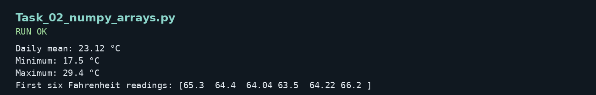

*Takeaway: Applying operations directly to NumPy arrays is cleaner and much faster than writing `for` loops in Python.*

---

### Task 03: Vectorization vs Loops Benchmark
- **File:** [Task_03_vectorization.py](Task_03_vectorization.py)
- **Screenshot:** [screenshots/Task_03_vectorization.png](screenshots/Task_03_vectorization.png)

#### What I Did
To see why vectorization is so important in scientific computing, I benchmarked two ways of processing 1,000,000 latency measurements:
- **Loop version:** A standard Python list comprehension converting milliseconds to seconds squared: `[(x / 1000.0) ** 2 for x in latency_ms]`.
- **Vectorized version:** A direct NumPy array operation: `(latency_ms / 1000.0) ** 2`.

I timed both using Python's `timeit` module.

#### Code Output
```text
First five squared latency values: [0.03787665 0.01266192 0.04637842 0.03092504 0.00078812]
Loop time: 0.1507 s
Vectorized time: 0.0030 s
Approximate speed-up: 49.7x
```

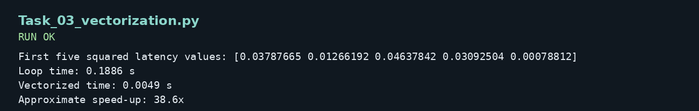

*Takeaway: The vectorized NumPy version is about 50 times faster because it executes compiled C code under the hood and avoids Python loop overhead.*

---

### Task 04: Numerical Errors & Catastrophic Cancellation
- **File:** [Task_04_numerical_errors.py](Task_04_numerical_errors.py)
- **Screenshot:** [screenshots/Task_04_numerical_errors.png](screenshots/Task_04_numerical_errors.png)

#### What I Did
This task explores two classic floating-point pitfalls:
1. **Precision limits:** `0.1 + 0.2` equals `0.30000000000000004` rather than `0.3` because computers store decimals in binary (base 2). Because of this, exact checks `==` fail, and we must use tolerance checks like `np.isclose()`.
2. **Catastrophic cancellation:** Evaluating $\frac{\sqrt{1+x}-1}{x}$ when $x$ is very small causes subtraction of two numbers that are almost identical ($\sqrt{1+x} \approx 1$). This loses significant digits.
   - *Fix:* Multiply top and bottom by the conjugate $(\sqrt{1+x}+1)$ to rewrite it as $\frac{1}{\sqrt{1+x}+1}$.

#### Code Output
```text
0.1 + 0.2 = 0.30000000000000004
Exact comparison: False
Tolerance-based comparison: True
Absolute error: 0.00021356
Relative error: 0.01510114%
x=1e-04: direct=0.499987500624, stable=0.499987500625
x=1e-08: direct=0.499999996961, stable=0.499999998750
x=1e-12: direct=0.500044450291, stable=0.500000000000
```

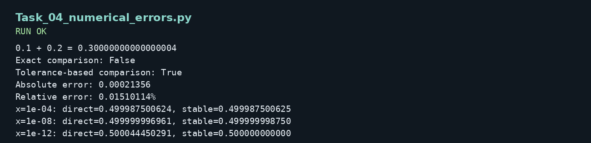

*Takeaway: At $x = 10^{-12}$, the direct calculation starts drifting and gives an inaccurate result ($0.500044$), while the algebraically rewritten formula stays exact at $0.500000$.*

---

### Task 05: 2D Matrix Transformations & Geometry
- **File:** [Task_05_matrix_algebra.py](Task_05_matrix_algebra.py)
- **Screenshot:** [screenshots/Task_05_matrix_algebra.png](screenshots/Task_05_matrix_algebra.png)

#### What I Did
I started with the 4 corner points of a unit square and applied two geometric transformations:
1. Scaling: 2.0x along the x-axis and 1.5x along the y-axis.
2. Rotation: $45^\circ$ counter-clockwise.
3. Composite matrix: Combined them into a single matrix $M = R \cdot S$ and transformed the coordinates using $P' = P \cdot M^T$.
4. Checked the determinant $\det(M)$, which tells us how much the original area expanded.

#### Code Output
```text
Original points:
 [[0. 0.]
 [1. 0.]
 [1. 1.]
 [0. 1.]]
Transformation matrix:
 [[ 1.41421356 -1.06066017]
 [ 1.41421356  1.06066017]]
Transformed points:
 [[ 0.          0.        ]
 [ 1.41421356  1.41421356]
 [ 0.35355339  2.47487373]
 [-1.06066017  1.06066017]]
Determinant: 2.9999999999999996
```

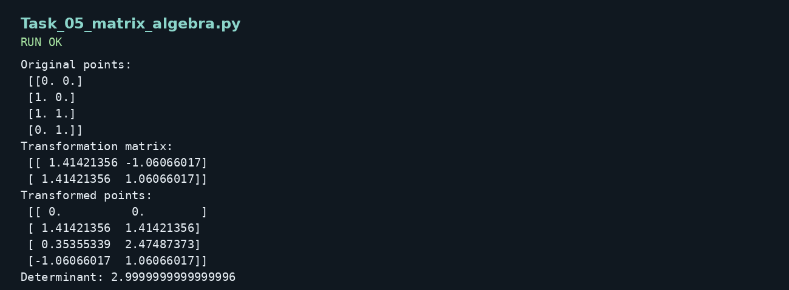

*Takeaway: The determinant is 3.0, which matches the area scaling factor ($2.0 \times 1.5 = 3.0$), because pure rotation does not change area.*

---

### Task 06: Solving Linear Systems Directly
- **File:** [Task_06_linear_systems.py](Task_06_linear_systems.py)
- **Screenshot:** [screenshots/Task_06_linear_systems.png](screenshots/Task_06_linear_systems.png)

#### What I Did
I solved a practical resource allocation problem: finding how many Type A and Type B servers to deploy to satisfy two capacity requirements:
$$\begin{cases} 4x_1 + 2x_2 = 20 \\ 8x_1 + 12x_2 = 72 \end{cases}$$

I solved $A x = b$ using `np.linalg.solve(A, b)` and computed the residual vector $r = b - A x$ and its Euclidean norm $\|r\|_2$ to verify that the solution is exact.

#### Code Output
```text
Type A servers: 3
Type B servers: 4
Verification: [20. 72.]
Residual: [0. 0.]
Residual norm: 0.0
```

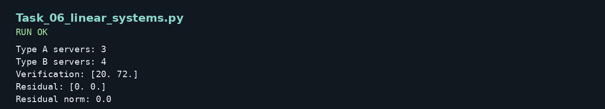

*Takeaway: The solver found the exact integer solution of 3 Type A servers and 4 Type B servers with zero residual error.*

---

### Task 07: LU Factorization with Pivoting
- **File:** [Task_07_gaussian_lu.py](Task_07_gaussian_lu.py)
- **Screenshot:** [screenshots/Task_07_gaussian_lu.png](screenshots/Task_07_gaussian_lu.png)

#### What I Did
When we have the same system matrix $A$ but need to solve it for multiple different measurements $b$, running Gaussian elimination from scratch every time is wasteful.
Instead, I used LU decomposition ($P A = L U$):
1. Factored matrix $A$ once using `scipy.linalg.lu_factor(A)`.
2. Solved for 3 different measurement vectors using `scipy.linalg.lu_solve()`.

#### Code Output
```text
Set 1: [5. 5. 5.]; residual=0.00e+00
Set 2: [5.31707317 5.26829268 4.75609756]; residual=1.78e-15
Set 3: [4.90243902 5.6097561  5.53658537]; residual=0.00e+00
```


*Takeaway: Once factored, each additional solution only requires quick forward and back substitutions ($O(n^2)$ time instead of $O(n^3)$).*

---

### Task 08: Gauss-Seidel Iterative Solver
- **File:** [Task_08_iterative_linear.py](Task_08_iterative_linear.py)
- **Screenshot:** [screenshots/Task_08_iterative_linear.png](screenshots/Task_08_iterative_linear.png)

#### What I Did
Instead of direct solvers, large sparse matrices in engineering are often solved iteratively. 
Here I wrote a Gauss-Seidel solver from scratch:
- It repeatedly updates each variable using the newest values available in the current iteration.
- Stops when the residual norm $\|A x - b\|$ falls below $10^{-10}$.
- Plotted the residual drop on a logarithmic scale (`plt.semilogy`).

#### Code Output
```text
Gauss-Seidel solution: [5. 5. 5.]
Iterations: 15
Direct solution: [5. 5. 5.]
```

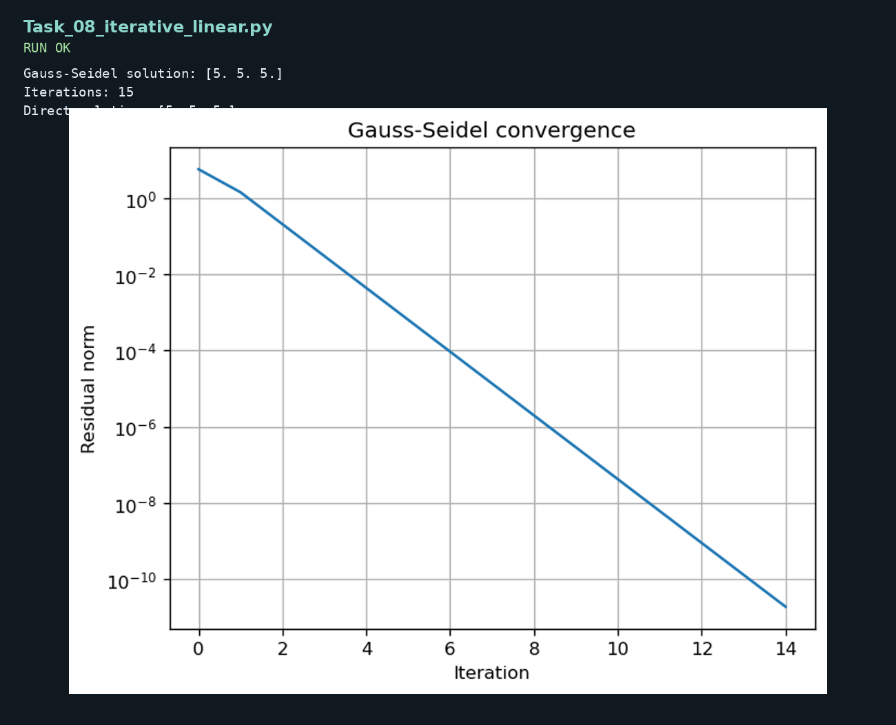

*Takeaway: The method took only 15 iterations to reach machine-level accuracy, and the semilog plot shows a clear straight-line geometric convergence.*

---

### Task 09: Eigenvalues & Network Centrality
- **File:** [Task_09_eigenvalues.py](Task_09_eigenvalues.py)
- **Screenshot:** [screenshots/Task_09_eigenvalues.png](screenshots/Task_09_eigenvalues.png)

#### What I Did
Given the adjacency matrix of a 4-node network, I calculated its eigenvalues and eigenvectors using `np.linalg.eig`.
According to the Perron-Frobenius theorem, the eigenvector associated with the largest positive eigenvalue gives the **eigenvector centrality** (the same concept behind Google's PageRank), showing which nodes have the most influence in the network.

#### Code Output
```text
Eigenvalues: [ 2.56155281e+00+0.j -9.25942537e-17+0.j -1.56155281e+00+0.j -1.00000000e+00+0.j]
Dominant eigenvalue: 2.561552812808829
Normalized eigenvector centrality: [0.21922359 0.28077641 0.28077641 0.21922359]
```

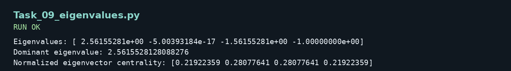

*Takeaway: The middle nodes (indices 1 and 2) have higher centrality ($28.1\%$) than the end nodes ($21.9\%$) because they have more connections.*

---

### Task 10: Root Finding (Bisection & Fixed-Point)
- **File:** [Task_10_bisection_fixed_point.py](Task_10_bisection_fixed_point.py)
- **Screenshot:** [screenshots/Task_10_bisection_fixed_point.png](screenshots/Task_10_bisection_fixed_point.png)

#### What I Did
This task demonstrates two fundamental root-finding techniques:
1. **Bisection Method:** Solved a thermal equilibrium equation $0.02(t - 20)^2 - 12 = 0$ inside the bracket $[20, 50]$ using `scipy.optimize.root_scalar`. It continually cuts the bracket in half until it pinpoints the root.
2. **Fixed-Point Iteration:** Used the ancient Babylonian formula $x_{k+1} = \frac{1}{2}(x_k + \frac{2}{x_k})$ to find $\sqrt{2}$.

#### Code Output
```text
Bisection equilibrium temperature: 44.494897 °C
Fixed-point sqrt(2): 1.414213562373 in 6 iterations
```


*Takeaway: The bisection method reliably found $t \approx 44.49^\circ\text{C}$, while the Babylonian fixed-point iteration converged to 12 decimal places of $\sqrt{2}$ in just 6 steps.*

---

### Task 11: Newton-Raphson & Secant Methods (IRR)
- **File:** [Task_11_newton_secant.py](Task_11_newton_secant.py)
- **Screenshot:** [screenshots/Task_11_newton_secant.png](screenshots/Task_11_newton_secant.png)

#### What I Did
I solved for the Internal Rate of Return (IRR) of an investment project with cash flows $[-1000, 400, 400, 400]$, which means finding the discount rate $r$ where Net Present Value $\text{NPV}(r) = 0$.
- **Newton-Raphson:** Uses the exact derivative $\text{NPV}'(r)$ to take tangent steps toward the root.
- **Secant Method:** Approximates the slope using two recent points, so it does not need an analytical derivative.

#### Code Output
```text
Newton interest rate: 9.701026%; NPV=-5.684e-14
Secant interest rate: 9.701026%; NPV=-5.684e-14
```


*Takeaway: Both methods found the exact IRR ($9.70\%$) with essentially zero residual error. The Secant method is especially handy when calculating the derivative by hand is tedious.*

---

### Task 12: Nonlinear Systems (Circle & Parabola)
- **File:** [Task_12_nonlinear_equations.py](Task_12_nonlinear_equations.py)
- **Screenshot:** [screenshots/Task_12_nonlinear_equations.png](screenshots/Task_12_nonlinear_equations.png)

#### What I Did
I solved a multivariable system of two nonlinear equations representing where a circle of radius 5 intersects a parabola:
$$\begin{cases} x^2 + y^2 - 25 = 0 \\ y - \frac{x^2}{4} = 0 \end{cases}$$
I used `scipy.optimize.root` with an initial guess of $(x_0, y_0) = (2.0, 3.0)$.

#### Code Output
```text
Converged: True
Circle/parabola intersection: [3.67976347 3.38516481]
Residual: [-1.49213975e-13  1.90070182e-13]
```


*Takeaway: The solver converged rapidly to $(x \approx 3.68, y \approx 3.39)$ with residuals on the order of $10^{-13}$.*

---

### Task 13: Linear vs Cubic Spline Interpolation
- **File:** [Task_13_interpolation.py](Task_13_interpolation.py)
- **Screenshot:** [screenshots/Task_13_interpolation.png](screenshots/Task_13_interpolation.png)

#### What I Did
Given hourly temperature readings at hours $0, 1, 2, 3, 4, 5, 6$, I compared two interpolation methods:
- **Piecewise Linear:** Draws straight line segments between points.
- **Cubic Spline:** Fits smooth 3rd-degree polynomials that match up both slopes and curvature at the knots.
I also estimated the temperature at $t = 2.5$ hours.

#### Code Output
```text
Estimated temperature at 2.5 h: 23.94 °C
```

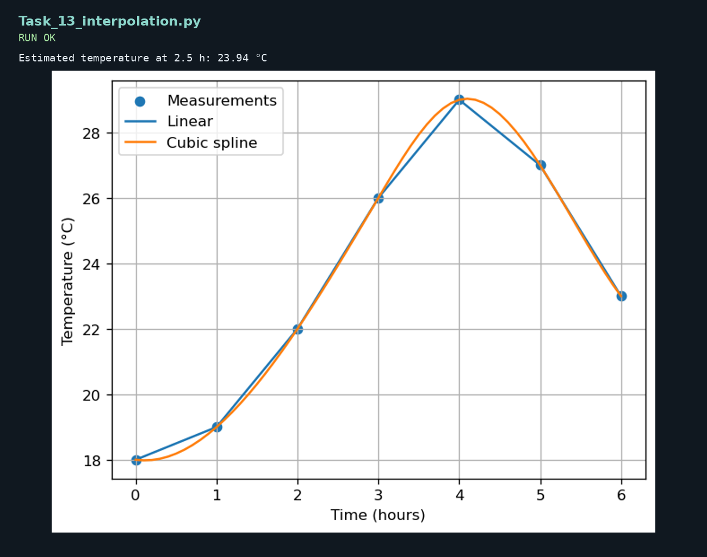

*Takeaway: As seen in the plot, linear interpolation creates sharp, unnatural corners, while cubic splines produce a smooth curve that better reflects physical temperature changes.*

---

### Task 14: Curve Fitting (Latency vs Users)
- **File:** [Task_14_curve_fitting.py](Task_14_curve_fitting.py)
- **Screenshot:** [screenshots/Task_14_curve_fitting.png](screenshots/Task_14_curve_fitting.png)

#### What I Did
I took benchmark data showing server response time (ms) under different numbers of concurrent users and fitted a linear performance model:
$$\text{Response Time} = \beta_0 + \beta_1 \cdot \text{users}$$
I used `scipy.optimize.curve_fit` to estimate the parameters and calculated the coefficient of determination ($R^2$).

#### Code Output
```text
Fitted response = 77.67 + 2.61 * users
R²: 0.9837
```

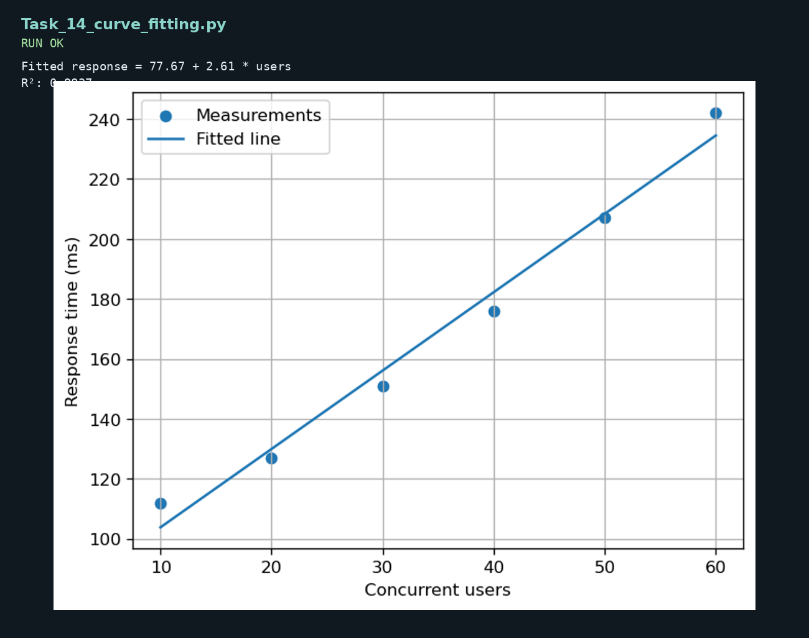

*Takeaway: The server has an initial baseline latency of $77.67$ ms, adding about $2.61$ ms for every additional concurrent user. The high $R^2 = 0.9837$ shows that a linear model fits the data very well.*

---

### Task 15: Numerical Differentiation (GPS Speed)
- **File:** [Task_15_numerical_differentiation.py](Task_15_numerical_differentiation.py)
- **Screenshot:** [screenshots/Task_15_numerical_differentiation.png](screenshots/Task_15_numerical_differentiation.png)

#### What I Did
Given GPS position readings sampled once every second, I estimated the vehicle's speed using finite differences:
- **At the start ($t=0$):** Forward difference $\frac{x_1 - x_0}{\Delta t}$.
- **In the middle ($t=1$ to $5$):** Central difference $\frac{x_{i+1} - x_{i-1}}{2\Delta t}$ (which is more accurate, $O(h^2)$).
- **At the end ($t=6$):** Backward difference $\frac{x_6 - x_5}{\Delta t}$.

#### Code Output
```text
t=0s, position=0.0m, estimated speed=4.80m/s
t=1s, position=4.8m, estimated speed=5.10m/s
t=2s, position=10.2m, estimated speed=5.65m/s
t=3s, position=16.1m, estimated speed=6.25m/s
t=4s, position=22.7m, estimated speed=6.95m/s
t=5s, position=30.0m, estimated speed=7.65m/s
t=6s, position=38.0m, estimated speed=8.00m/s
```

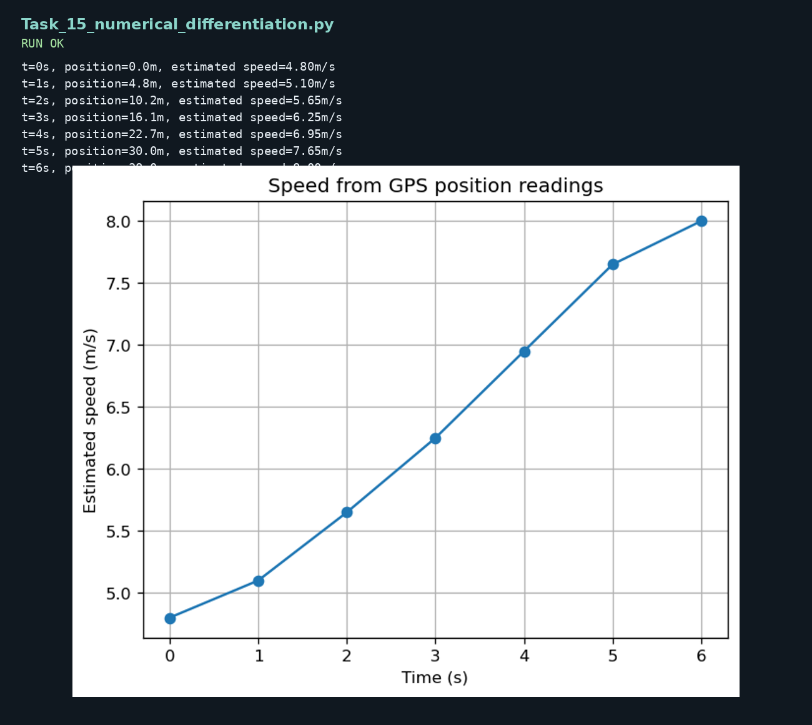

*Takeaway: The vehicle speed steadily increases from $4.8$ m/s to $8.0$ m/s. The central difference formula produces smooth, reliable speed estimates.*

---

### Task 16: Numerical Integration (Trapezoidal vs Simpson's)
- **File:** [Task_16_numerical_integration.py](Task_16_numerical_integration.py)
- **Screenshot:** [screenshots/Task_16_numerical_integration.png](screenshots/Task_16_numerical_integration.png)

#### What I Did
I calculated the total electrical energy consumed over 12 hours from power readings taken every 2 hours:
$$\text{Energy (kWh)} = \int_0^{12} P(t) \, dt$$
I compared two numerical integration methods:
1. **Trapezoidal Rule (`np.trapezoid`):** Approximates the area under the curve using trapezoids.
2. **Simpson's Rule (`scipy.integrate.simpson`):** Fits parabolas across consecutive points for higher accuracy.

#### Code Output
```text
Energy using trapezoidal rule: 15.700 kWh
Energy using Simpson's rule: 15.800 kWh
Difference: 0.100 kWh
```


*Takeaway: The two methods differ by $0.100$ kWh because Simpson's rule captures the smooth curvature of the power curve better than straight trapezoids.*

---

### Task 17: Solving ODEs with Euler's Method
- **File:** [Task_17_euler_ode.py](Task_17_euler_ode.py)
- **Screenshot:** [screenshots/Task_17_euler_ode.png](screenshots/Task_17_euler_ode.png)

#### What I Did
I simulated the cooling of a hot liquid using Newton's Law of Cooling:
$$\frac{dT}{dt} = -k (T - T_{\text{ambient}})$$
- Ambient temperature: $25^\circ\text{C}$, Initial temperature: $90^\circ\text{C}$, cooling rate: $k = 0.12\text{ min}^{-1}$.
- I stepped forward using **Euler's method** ($T_{n+1} = T_n - h \cdot k (T_n - T_{\text{amb}})$) with a 1-minute step size over 30 minutes.
- Compared the numerical result against the exact analytical formula $T(t) = 25 + 65 e^{-0.12 t}$.

#### Code Output
```text
Euler temperature after 30 min: 26.40 °C
Exact temperature after 30 min: 26.78 °C
Final absolute error: 0.3720 °C
```

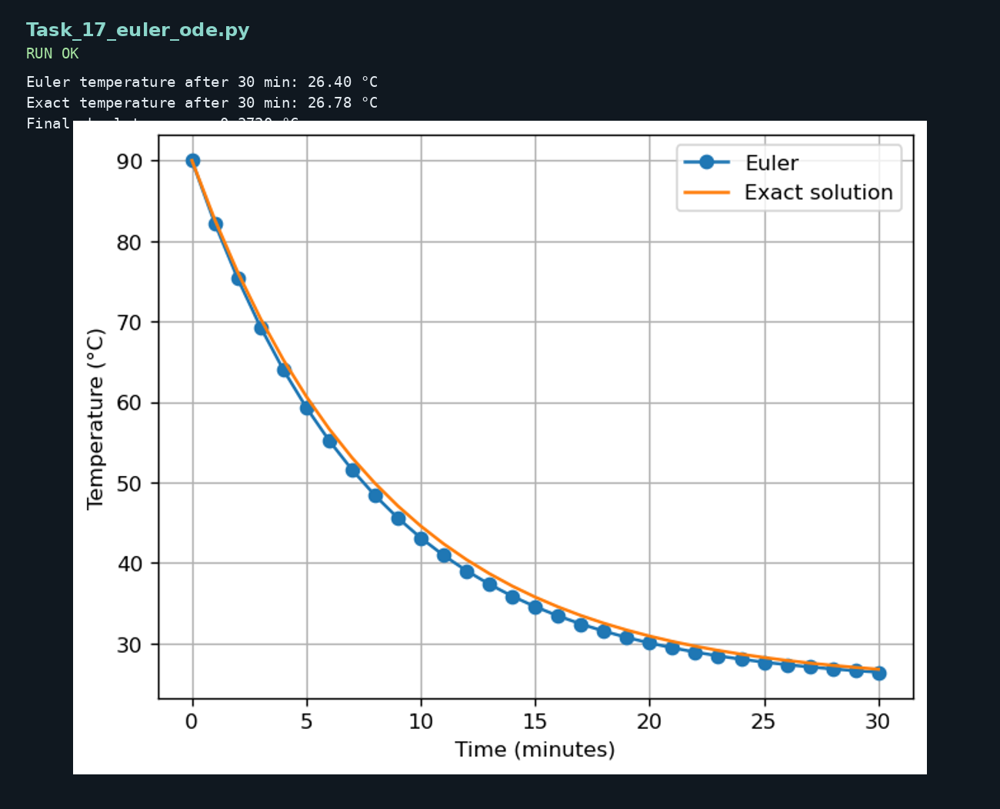

*Takeaway: Euler's method is easy to implement and follows the general cooling curve well, but with a 1-minute step size it drifts by about $0.37^\circ\text{C}$ due to accumulated truncation error.*

---

### Task 18: Solving ODEs with SciPy (RC Circuit)
- **File:** [Task_18_scipy_ode.py](Task_18_scipy_ode.py)
- **Screenshot:** [screenshots/Task_18_scipy_ode.png](screenshots/Task_18_scipy_ode.png)

#### What I Did
I modeled the charging of an RC electrical circuit:
$$\frac{dV}{dt} = \frac{V_s - V}{RC}$$
with supply voltage $V_s = 5$ V, resistance $R = 1000\,\Omega$, and capacitance $C = 1000\,\mu\text{F}$ (time constant $\tau = RC = 1.0$ s).
I used SciPy's adaptive ODE solver `solve_ivp` with the Runge-Kutta 4(5) algorithm and compared it against the exact formula $V(t) = 5(1 - e^{-t})$.

#### Code Output
```text
Solver success: True
Capacitor voltage at 5 s: 4.9663 V
Maximum error against exact: 9.282e-10 V
```

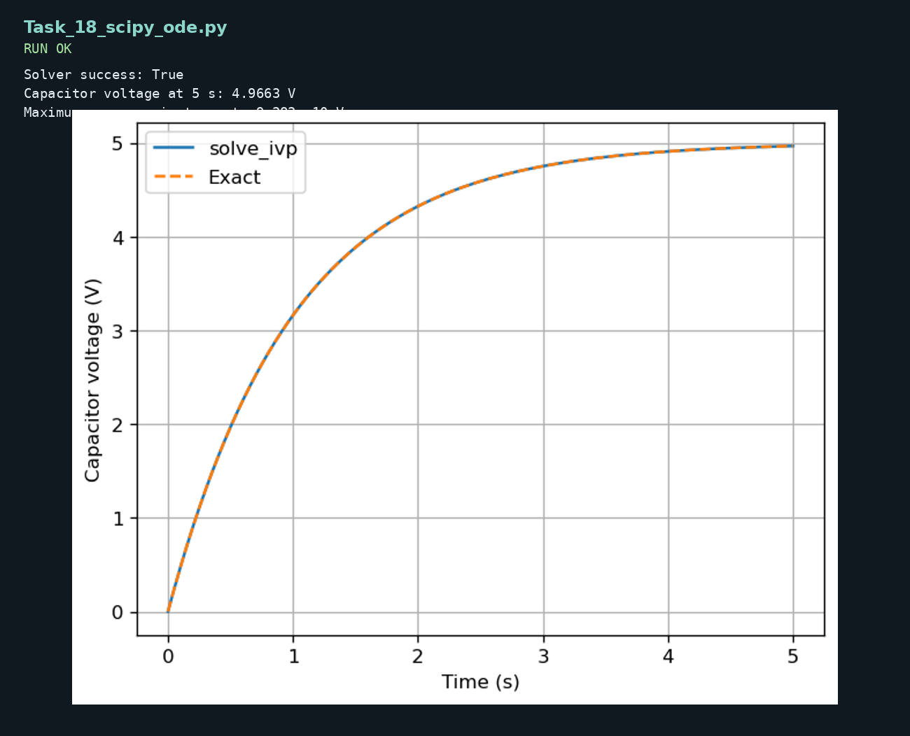

*Takeaway: SciPy's adaptive RK45 solver is accurate to less than one billionth of a volt ($< 10^{-9}$ V), showing why library ODE solvers are preferred over basic Euler for engineering problems.*

---

### Task 19: Constrained Server Optimization
- **File:** [Task_19_optimization.py](Task_19_optimization.py)
- **Screenshot:** [screenshots/Task_19_optimization.png](screenshots/Task_19_optimization.png)

#### What I Did
I solved a cost minimization problem to meet server capacity requirements:
- **Cost to minimize:** $12x + 18y$
- **Capacity constraint:** $100x + 170y \ge 1000$ (must support at least 1000 requests)
- **Non-negativity:** $x \ge 0, y \ge 0$

1. Solved the continuous version using `scipy.optimize.minimize` with the SLSQP method.
2. Ran a grid search to find the best integer solution, because in the real world you cannot buy a fraction of a server.

#### Code Output
```text
Optimization success: True
Type A allocation: 0.000
Type B allocation: 5.882
Total capacity: 1000.00
Minimum planning cost: 105.88
Best whole-server solution: (108, 0, 6, 1020)
```


*Takeaway: Type B servers give more capacity per dollar ($170 / \$18 \approx 9.44$ units/\$) than Type A ($100 / \$12 \approx 8.33$ units/\$). The best real-world choice is to buy 6 Type B servers for $\$108$, providing $1020$ units of capacity.*

---

### Task 20: Monte Carlo Risk Simulation
- **File:** [Task_20_monte_carlo.py](Task_20_monte_carlo.py)
- **Screenshot:** [screenshots/Task_20_monte_carlo.png](screenshots/Task_20_monte_carlo.png)

#### What I Did
To estimate the risk of server capacity overload under random traffic:
- User traffic follows a normal distribution: $\text{Demand} \sim \mathcal{N}(\mu=850, \sigma=120)$.
- Server capacity limit: $1000$.
- I simulated 100,000 random requests and counted how many exceeded capacity.
- Plotted the running probability estimate across increasing simulation counts (`plt.semilogx`).

#### Code Output
```text
Estimated overload probability: 10.6160%
Overload cases: 10616 out of 100000
```

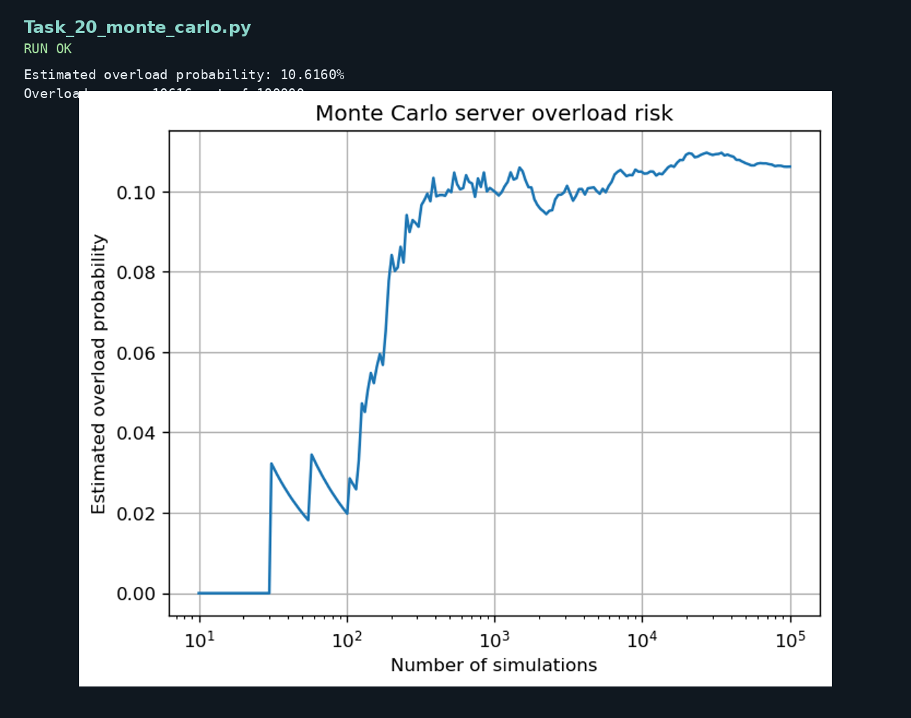

*Takeaway: The simulation shows an overload probability of about $10.6\%$, which closely matches the theoretical normal probability ($10.56\%$). The log plot demonstrates how the estimate stabilizes as the number of simulations grows.*

---

### Task 21: Cold-Chain Container Simulation
- **File:** [Task_21_cold_chain.py](Task_21_cold_chain.py)
- **Screenshot:** [screenshots/Task_21_cold_chain.png](screenshots/Task_21_cold_chain.png)

#### What I Did
This is an applied case study in vaccine supply chain logistics. Medicines start at $8.0^\circ\text{C}$ and must stay strictly at or below $10.0^\circ\text{C}$ during a 12-hour transport in an outside temperature of $32.0^\circ\text{C}$.
I solved the warming differential equations for two cooler box types using `solve_ivp`:
- **Standard box:** Warming rate $k = 0.18\text{ h}^{-1}$
- **Insulated box:** Warming rate $k = 0.07\text{ h}^{-1}$

#### Code Output
```text
standard container: final temperature=29.23 °C
standard container: exceeds 10.0 °C at about 0.50 hours
insulated container: final temperature=21.64 °C
insulated container: exceeds 10.0 °C at about 1.25 hours
```

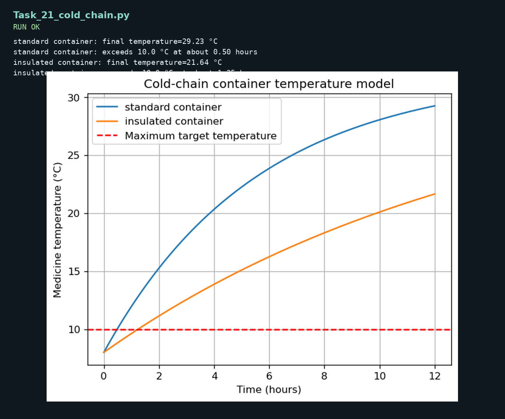

#### Practical Findings
- The **standard box** warms past the $10.0^\circ\text{C}$ threshold in only **30 minutes**, reaching over $29^\circ\text{C}$ by the end of the trip (ruining the shipment).
- The **insulated box** lasts about **1 hour and 15 minutes** before exceeding the safety limit.
- *Conclusion:* Neither passive container can keep the medicine safe for a full 12-hour trip without adding ice packs or active refrigeration.

---

## Key Observations

1. **Vectorization is essential:** NumPy array math was ~50x faster than standard Python loops because it avoids interpreter overhead and runs in compiled C.
2. **Watch out for floating-point cancellation:** Subtracting nearly identical numbers can wipe out accuracy; rewriting equations algebraically prevents this error.
3. **Choosing the right linear solver:** LU decomposition is fastest when solving for several right-hand sides with the same matrix. Iterative solvers like Gauss-Seidel are great for large sparse systems.
4. **Differentiation & Integration formulas:** Higher-order methods (like central differences and Simpson's rule) capture curvature and give significantly more accurate answers than one-sided or trapezoidal approximations.
5. **ODEs in practice:** While Euler's method is intuitive, adaptive solvers like SciPy's RK45 are far superior for real problems, achieving errors under $10^{-9}$.
